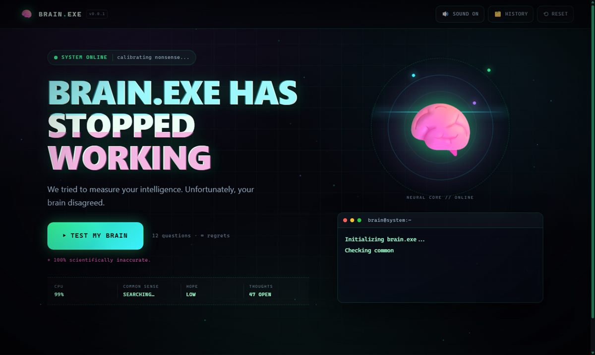
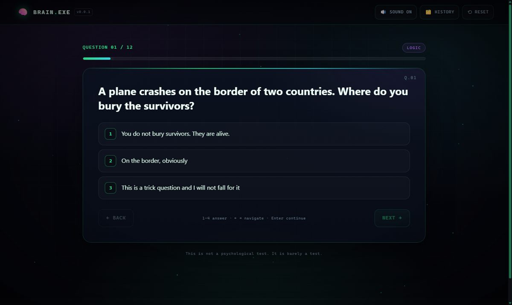
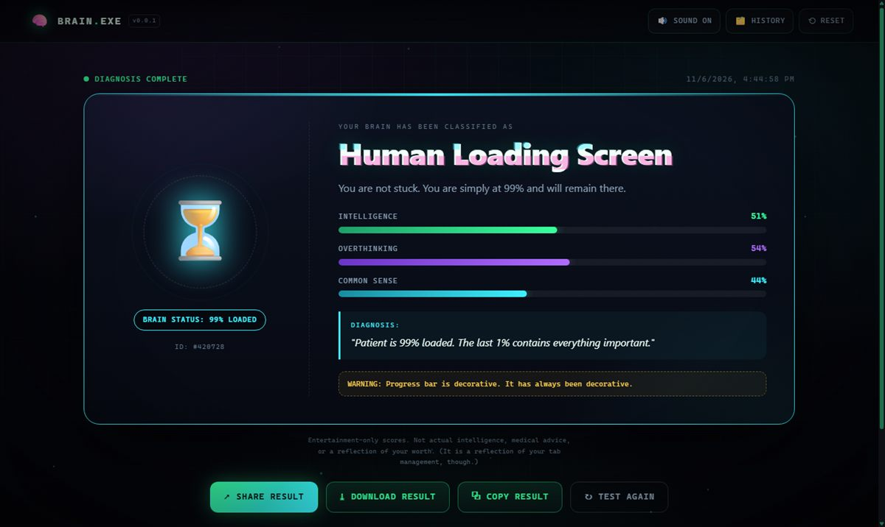
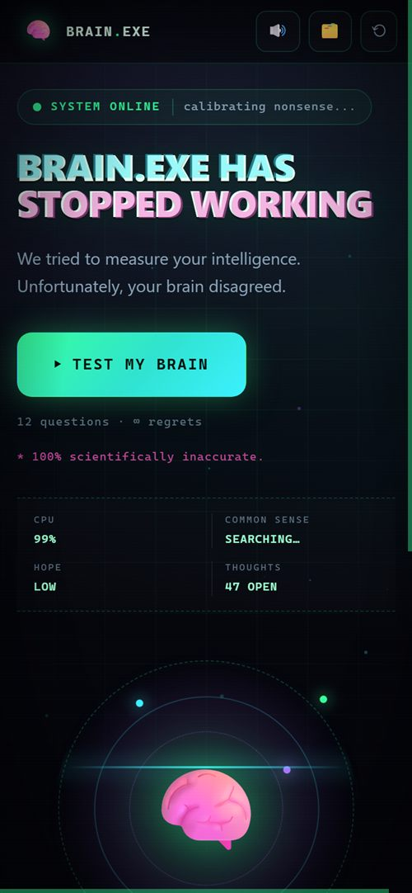

<h1 align="center">🧠 Brain.exe Has Stopped Working</h1>

<p align="center">
  <strong>We tried to measure your intelligence. Unfortunately, your brain disagreed.</strong>
</p>

<p align="center">
  <a href="https://sufianselim.github.io/brain.exe/"></a>
  
  
  
  
  
</p>

<p align="center">
  A retro-futuristic, fake brain-diagnostic website built with plain HTML, CSS, and JavaScript.<br>
  Twelve questionable questions. One deeply unscientific diagnosis. Zero useful data.
</p>

<p align="center">
  
</p>

---

## ▶ Live demo

**[https://sufianselim.github.io/brain.exe/](https://sufianselim.github.io/brain.exe/)**

No accounts, no downloads, no data collection. Open it, answer badly, share the damage.

---

## Overview

Brain.exe presents itself as a malfunctioning computer diagnostic tool. It boots into a CRT-inspired terminal, runs a "neural scan", asks whether ketchup is a smoothie, and then classifies you as something like **Certified Overthinker**, **Potato Brain**, or **Certified Genius (Probably Fake)**.

It is a joke with a progress bar — not an IQ test, psychological assessment, or medical advice.

Everything runs client-side. No frameworks, no build step, no backend, no external APIs, and no network requests after the page loads.

---

## Features

### 🖥️ The landing page
- Animated neon brain core with orbit rings, glow, and a scanning sweep.
- Live "system status" chatter that keeps changing while you read.
- Looping terminal that types diagnostic messages in real time.
- Glitch typography, CRT scanlines, animated grid, and ambient particle canvas.

### 🧪 The test
- **36-question bank** randomly sampled into a **12-question test**.
- Questions spread across six categories: Overthinking, Common Sense, Logic, Random Thoughts, Everyday Situations, and Imagination.
- Questions from your previous run are remembered and avoided where possible.
- Progress bar, question counter, category badge, and animated card transitions.
- 2–4 answers per question, each with its own reaction line.
- Back / Next navigation, with the final question becoming **Finish Test**.
- **Test Again** restarts the whole thing from the result screen.

### 🔬 The fake analysis
- Staged terminal sequence with progress climbing from 0% to 100%.
- Deliberate failures such as `ERROR: Logic not found.` and `Brain.exe has stopped responding.`
- Occasional fake crash dialogs with **Retry** and **Ignore (Recommended)**.
- Reduced-motion users get the same content without the typing delay.

### 📊 The result
- **12 result archetypes**, each with its own title, status, glyph, colour, description, diagnosis, and warning.
- Intelligence, Overthinking, and Common Sense scores derived from your answers plus a little chaos.
- Animated stat bars and a diagnostic quote.
- Automatic history — the last **20 runs** are stored locally.
- Entertainment-only disclaimer on every result.

### 📤 Sharing
- **Share Result** uses the Web Share API where supported, with the generated PNG when possible.
- **Download Result** exports a **1080 × 1080** social-ready card rendered with Canvas.
- **Copy Result** uses the Clipboard API with a legacy `execCommand` fallback.
- If native sharing is unavailable, a share modal opens with a preview, copyable text, and download options.
- The share card includes the site name, result title, status, scores, diagnosis, and disclaimer.

### ✨ Extras
- Web Audio sound effects with a persistent mute toggle.
- Dark theme by default.
- Keyboard navigation: `1–4`, `←`, `→`, `Enter`, and `Esc`.
- LocalStorage preferences, result history, and recent-question memory.
- Reset button with confirmation.
- Hidden easter egg: click the brain logo **five times**.
- Respects `prefers-reduced-motion` and degrades gracefully when Canvas, Web Audio, Clipboard, Web Share, or `localStorage` are unavailable.

---

## Screenshots

| The test | The diagnosis |
| :---: | :---: |
|  |  |

<details>
<summary><strong>📱 Mobile view</strong> (click to expand)</summary>
<br>
<p align="center">
  
</p>
</details>

---

## Tech stack

| Layer | Choice |
| --- | --- |
| Markup | HTML5 |
| Styling | CSS3 — custom properties, grid, flexbox, keyframe animations, media queries |
| Logic | Vanilla JavaScript (ES6+), classic scripts — no bundler |
| Graphics | CSS-generated effects + Canvas API for particles and the share card |
| Sound | Web Audio API — synthesized, no audio files |
| Sharing | Web Share API, Clipboard API, Canvas `toDataURL` / `toBlob` |
| Persistence | `localStorage` only |
| Dependencies | **None** |

There is no `node_modules`, no package manager, and no build pipeline. The files in this repository are the finished site.

---

## Run locally

### Just open it
Double-click `index.html`, or drag it into a browser. That is the whole setup.

### Clone the repository

```bash
git clone https://github.com/sufianselim/brain.exe.git
cd brain.exe
```

Then open `index.html` directly.

### Optional local server

Some browser APIs (notably Clipboard and native file sharing) behave better on `http://localhost` than on `file://`.

```bash
# Python
python -m http.server 8000

# or Node
npx serve .
```

Visit `http://localhost:8000/`.

---

## How it works

1. **Question selection** — `js/questions.js` holds 36 questions across six categories. Each test takes 12, round-robin across shuffled categories, and avoids IDs used in the previous session when possible.
2. **Answer weighting** — every option carries hidden weights for intelligence, overthinking, and common sense. `js/results.js` averages those weights against a neutral baseline and adds a small amount of random noise.
3. **Result selection** — each of the 12 archetypes has a scoring function over the three stats. The final title is chosen with weighted randomness, biased toward your dominant traits and discouraged from repeating immediately.
4. **Presentation** — the analysis terminal, result dashboard, history, sound effects, and share card are all rendered from those values.
5. **Privacy** — answers never leave the browser. Only preferences and history are written to `localStorage`.

The numbers are decorations. Please do not put them on a résumé.

---

## Project structure

```
brain.exe/
├── index.html                  # Screens, modals, and structural markup
├── css/
│   └── style.css               # Theme, CRT effects, animations, responsive layout
├── js/
│   ├── questions.js            # 36-question bank + balanced random selection
│   ├── storage.js              # Defensive localStorage wrapper
│   ├── effects.js              # Web Audio, typewriter, particles, toasts, fake errors
│   ├── results.js              # Scoring, result catalogue, analysis, Canvas sharing
│   ├── quiz.js                 # Quiz state machine and keyboard controls
│   └── app.js                  # Screen routing, modals, history, easter egg
├── docs/
│   └── screenshots/            # README images
└── README.md
```

Scripts are loaded as classic scripts rather than ES modules so the site works when `index.html` is opened straight from the filesystem, where module imports are often blocked by browser CORS rules.

---

## Deploy to GitHub Pages

This repository is already deployed from the `main` branch root. To deploy your own copy:

1. Push the project so `index.html` is at the repository root.
2. Open **Settings → Pages**.
3. Under **Build and deployment**, choose **Deploy from a branch**.
4. Select `main` and the `/ (root)` folder.
5. Save. The site publishes at `https://<username>.github.io/<repository>/`.

No build step or environment variables are required.

---

## Keyboard shortcuts

| Key | Action |
| --- | --- |
| `1` – `4` | Select the corresponding answer |
| `→` | Next question (when answered) |
| `←` | Previous question |
| `Enter` | Continue from the focused question card |
| `Esc` | Close the open dialog |

---

## LocalStorage keys

| Key | Contents |
| --- | --- |
| `brainexe.prefs.v1` | Sound preference |
| `brainexe.history.v1` | Last 20 results (title, status, scores, date, glyph) |
| `brainexe.recent.v1` | Question IDs used in the previous test |
| `brainexe.eggs.v1` | Easter-egg counter storage (reserved) |

The **Reset** button (with confirmation) clears all of it.

---

## Browser compatibility

| Feature | Behaviour |
| --- | --- |
| Core experience | Chrome, Edge, Firefox, Safari, and modern mobile browsers |
| Web Share API | Used automatically where supported; fallback modal otherwise |
| Clipboard API | Used on secure contexts; legacy `execCommand` fallback included |
| Canvas share image | Works in all Canvas-capable browsers; `toDataURL` fallback included |
| Web Audio API | Optional; silently skipped if unavailable |
| `localStorage` | Optional; the test still runs if storage is blocked |
| `prefers-reduced-motion` | Disables typing delays and ambient animation |

The full quiz flow, analysis, result rendering, Canvas export, share fallback, history, reset, sound persistence, easter egg, keyboard controls, and mobile layout were verified in headless Chromium with zero console errors.

---

## Privacy

- No accounts, analytics, trackers, cookies, or external requests.
- Answers are processed entirely in your browser.
- Preferences and history stay in `localStorage` and never leave the device.
- Clearing site data or using **Reset** removes everything.

---

## Disclaimer

**100% scientifically inaccurate.** Brain.exe is an entertainment project. Its scores, diagnoses, and warnings are jokes. It is not an intelligence test, a psychological assessment, medical advice, or a reflection of your worth.

It may, however, be an accurate reflection of your tab management.

---

## License

Do whatever you like with it. Attribution is appreciated but not required. No warranty; no brains were measured.
